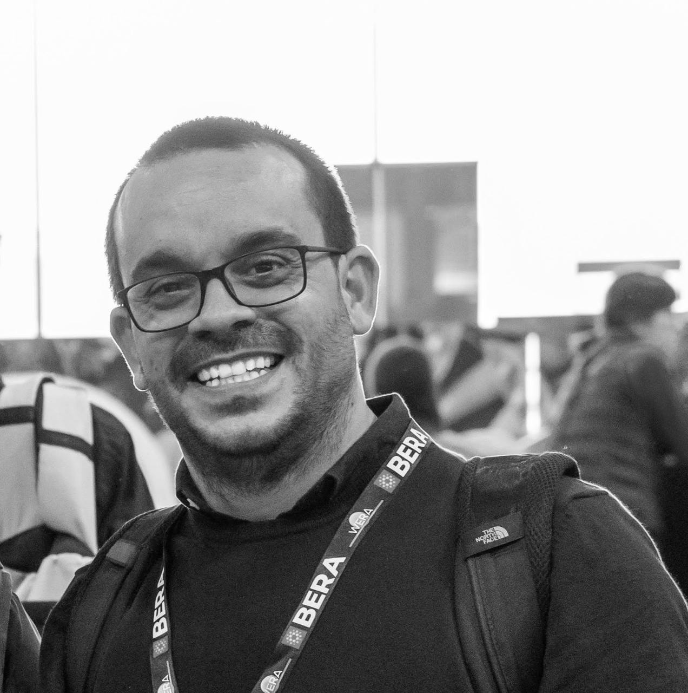

::::: intro
```{=html}

```

:::: intro-text
# Adrián Zancajo {.intro-name .unnumbered .unlisted}

::: role
Ramón y Cajal Researcher, [Department of Sociology](https://www.uab.cat/en/sociology), [Autonomous University of Barcelona](https://www.uab.cat/web/universitat-autonoma-de-barcelona-1345467954774.html). Member of the research group [Globalisation, Education and Social Policies (GEPS)](https://geps-uab.cat/).
:::

I study education privatisation and markets, education policy, and educational inequality. My work covers the political economy of education reforms, how policies are enacted in schools, and their effects on equity.

::: contact-row
[adrian.zancajo \[at\] uab \[dot\] cat]{.email}

[[[](https://orcid.org/0000-0002-4431-8155)]{.icon-link} [[](https://scholar.google.nl/citations?hl=en&user=mJmENSwAAJ)]{.icon-link} [[](https://uab.academia.edu/AdrianZancajo)]{.icon-link} [[](https://www.researchgate.net/profile/Adrian-Zancajo-2)]{.icon-link} [[](https://www.linkedin.com/in/azancajo)]{.icon-link} [[](https://x.com/AdrianZancajo)]{.icon-link} [[](https://bsky.app/profile/adrianzancajo.bsky.social)]{.icon-link}]{.profiles}
:::
::::
:::::

```{=html}
<script defer src="https://cdn.overtracking.com/t/tjs6NPq4iftwhE1H9/"></script>
```
